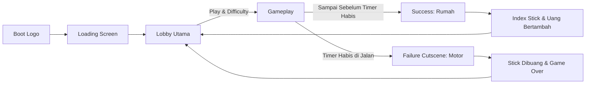

# 🪵 PROJECT: ROADSIDE STICK

<div align="center">


> *"Every road leads home, but not every stick makes it there."*

**Tema Kompetisi: PULANG**  
*2D Side-Scrolling Exploration • Stick Collection • Time Pressure*

</div>

---

## 📖 Daftar Isi
1. [Tentang Game](#-tentang-game)
2. [Pilar Desain & Core Loop](#-pilar-desain--core-loop)
3. [Alur Game (Game Flow)](#-alur-game-game-flow)
4. [Kontrol Permainan](#-kontrol-permainan)
5. [Spesifikasi Teknis](#-spesifikasi-teknis)
6. [Status Produksi & Checklist Tahap](#-status-produksi--checklist-tahap)
7. [Asset Manifest (Koleksi Aset)](#-asset-manifest-koleksi-aset)
8. [Panduan Kontributor & Tim Desain](#-panduan-kontributor--tim-desain)
9. [Changelog Terkini](#-changelog-terkini)

---

## 🎮 Tentang Game

**Roadside Stick** adalah game naratif eksplorasi 2D side-scrolling bernuansa nostalgia masa kecil berbalut pixel art 16-bit. 

Pemain berperan sebagai **Robi**, seorang anak SD yang sedang berjalan kaki menempuh perjalanan pulang dari sekolah ke rumahnya. Di sepanjang jalan desa dan pinggiran aspal, tergeletak berbagai jenis ranting dan kayu unik (*stick*)—mulai dari yang umum hingga yang amat langka.

Namun waktu terus berdetak! Robi harus tiba di depan pintu rumah sebelum timer habis. Jika terlambat, orang tuanya akan menyusul naik sepeda motor, membuang semua ranting yang dikumpulkan, dan perjalanan dianggap gagal. Dengan kapasitas tas yang sangat terbatas, pemain dituntut membuat keputusan cepat: ranting mana yang layak dibawa pulang?

<div align="center">

```text
       [ Sekolah ] ───( Jalan Pulang & Ranting )───> [ Rumah ]
          🚶 Robi                    🌿🪵                 🏡
      Timer Berjalan ⏳          Tas Terbatas 🎒        Sampai Tepat Waktu! 🏆
```

</div>

---

## 🌟 Pilar Desain & Core Loop

| Pilar | Deskripsi |
|---|---|
| ⏳ **The Journey** | Perjalanan linier ke kanan di bawah tekanan batas waktu sebelum orang tua menjemput. |
| 🪵 **The Collection** | Menemukan, memeriksa rarity, dan mengoleksi 12 ragam stick unik ke dalam Stick Index permanen. |
| ⚖️ **The Decision** | Tas berkapasitas terbatas (awal: 1). Pemain harus memilih antara mempertahankan stick lama atau menukarnya (*Swap Window*). |
| 📈 **The Progression** | Stick yang berhasil dibawa pulang menghasilkan uang untuk upgrade kapasitas tas, minuman penambah kecepatan (*Speed Drink*), serta kosmetik pakaian. |

> ⚠️ **Bukan Fokus Game:** Tidak ada combat, musuh, platforming lompat tinggi, puzzle rumit, atau skill tree.

---

## 🔄 Alur Game (Game Flow)



---

## 🕹️ Kontrol Permainan

| Input Keyboard | Aksi | Keterangan |
|:---:|---|---|
| <kbd>A</kbd> / <kbd>◀</kbd> | Bergerak ke Kiri | Robi berbalik arah ke kiri (*horizontal flip*) |
| <kbd>D</kbd> / <kbd>▶</kbd> | Bergerak ke Kanan | Berjalan menuju arah rumah |
| <kbd>E</kbd> | Ambil Stick | Interaksi saat prompt "E" muncul di atas ranting |
| <kbd>I</kbd> | Buka/Tutup Tas | Melihat isi inventory perjalanan saat ini |
| <kbd>Q</kbd> | Speed Drink | Mengaktifkan lari cepat sementara (*boost*) |
| <kbd>Esc</kbd> | Pause / Batal | Menjeda game atau menutup jendela modal teratas |
| <kbd>Mouse Klik</kbd> | Interaksi UI | Navigasi tombol di Lobby dan jendela tukar (*Swap*) |

---

## ⚙️ Spesifikasi Teknis

- **Game Engine:** GDevelop 5.6 (HTML5 Runtime)
- **Target Platform:** Web Browser (itch.io)
- **Resolusi Viewport:** 1024 × 576 px (Aspek Rasio 16:9, Landscape)
- **Mode Render:** Nearest-Neighbor (Pixel Perfect, Pixel Rounding aktif)
- **Framerate Target:** 60 FPS
- **Standar Tipografi:** Font `vcr.ttf` (VCR OSD Mono), warna default `#FFFFFF` putih murni, **bebas outline/stroke otomatis**.
- **Penyimpanan Lokal:** GDevelop Built-in Storage (`roadsidestick_save_v1` via Web localStorage).

---

## 🗺️ Status Produksi & Checklist Tahap

<details open>
<summary><b>Klik untuk melihat progres tiap tahap</b></summary>
<br>

- [x] **Tahap 0 — Foundation:** Pembersihan `game.json`, skema variabel global (`Save`, `Config`, `Data`, `Run`), 7 scene stub, sistem backup otomatis.
- [x] **Tahap 1 — Boot:** Layar putih solid, kemunculan logo developer `boot_logo_dev.png` tajam HD (884×198 px), efek kamera bergetar halus (*camera shake*) saat logo muncul, transisi fade halus menuju Loading.
- [x] **Tahap 2 — Loading Screen:** Background baru pixel art `DraftLoadingPXFix.png`, backsound santai `bgm_loading.mp3`, bar ramping 12px dengan action `ChangeWidth` presisi, spinner 8-frame animasi di sebelah kanan bar, load storage save.
- [x] **Tahap 3 — Lobby (Interactive Mockup & Living VFX):**
  - [x] Background `bg_lobby.png`.
  - [x] Karakter Robi animasi **Idle 10 Frame** presisi (128×128 looping), ditampilkan portrait kepala-pinggang besar (384×384 px) di sebelah kiri.
  - [x] Backsound nostalgic retro `bgm_menu.mp3` otomatis berganti saat memasuki menu.
  - [x] **VFX & Polishing Dinamis:** Efek bernapas halus (*breathe oscillation*) pada Robi serta efek denyut pendaran (*subtle opacity pulse*) pada tombol Play utama.
  - [x] 4 Tombol 3D beranimasi (`Normal`, `Hover`, `Pressed`): Mainkan (Kuning), Toko (Kuning), Koleksi (Ungu), Upgrade (Kuning).
  - [x] Indikator HUD teks level & uang berbasis font `vcr.ttf`.
- [ ] **Tahap 4 — Settings & About:** Modal pengaturan audio dan profil kreator.
- [x] **Tahap 5 — Difficulty Selection (Mockup Fungsional):** Modal pemilihan tingkat kesulitan (Peaceful, Easy, Normal, Hard, Super Hard) dengan navigasi panah `<` `>` dan tombol Mulai (*Confirm*) menuju scene Gameplay.
- [ ] **Tahap 6 — Stick Index:** Katalog 12 jenis stick dengan status terkunci/terbuka.
- [ ] **Tahap 7 — Shop (Toko Baju & Celana):** Kosmetik karakter Robi.
- [ ] **Tahap 8 — Upgrade Tas & Minuman:** Penambahan slot tas (1 s.d. 4) dan stok Speed Drink.
- [x] **Tahap 9 — Environment & Terrain Pijakan:** Susunan layer Gameplay (`BG_Sky`, `BG_Village`, `World`, `HUD`). Langit pagi `Langit_Pagi.png`, perumahan desa `Rumah dan Pohon.png`, dan deretan pijakan rumput `Rumput1..3.png` berjejer rapi di garis tanah Y=448 dengan kamera mengikuti horizontal.
- [x] **Tahap 10 — Karakter & Animasi Gerak Robi:** Player di Gameplay memiliki animasi Idle 10-frame dan animasi Walk 10-frame (presisi dari `robi_sd.png`), kontrol responsif gerak kiri/kanan (<kbd>A</kbd>/<kbd>D</kbd>) dengan auto horizontal flip.
- [ ] **Tahap 11 — Stick Spawner & Rarity:** Distribusi Common (70%), Uncommon (20%), Rare (8%), Very Rare (2%).
- [ ] **Tahap 12 — Gameplay HUD, Swap Window, & Timer:** Indikator jarak pulang dan modal tukar stick.
- [ ] **Tahap 13 — Success Scene:** Arrive Home, kalkulasi reward uang & penambahan stick ke Index.
- [ ] **Tahap 14 — Failure Cutscene & Game Over:** Motor orang tua menjemput, barang dibuang, opsi Retry.
- [ ] **Tahap 15 — Loop Permainan:** Peningkatan level dan siklus perjalanan baru.

</details>

---

## 📦 Asset Manifest (Koleksi Aset)

<details>
<summary><b>Lihat rincian ketersediaan aset per kategori</b></summary>
<br>

### 🖼️ Boot & Loading
| Aset | File | Dimensi | Status |
|---|---|:---:|:---:|
| Logo Developer | `ASSETS/BOOT/LOGO/boot_logo_dev.png` | 2213×496 | ✅ Siap (Tampilan Compact 480×108) |
| Loading Background (Tes64) | `ASSETS/BOOT/LOADING/Tes64.png` | 114×64 | ✅ Siap (Pixel Art Ilustratif 16:9) |
| Logo Game Loading | `ASSETS/BOOT/LOADING/Logo Gam.png` | 333×214 | ✅ Siap (Posisi Kiri Atas) |
| Loading Bar Frame | `ASSETS/BOOT/LOADING/boot_loading_bar_frame.png` | 1090×22 | ✅ Siap |
| Loading Bar Fill | `ASSETS/BOOT/LOADING/boot_loading_bar_fill.png` | 1090×22 | ✅ Siap |
| Spinner Indicator | `ASSETS/BOOT/LOADING/boot_loading_indicator_0..7.png` | 16×16 (8 frames) | ✅ Siap |
| Backsound Loading | `ASSETS/AUDIO/bgm_loading.mp3` | Audio MP3 | ✅ Siap |

### 🏠 Lobby & UI
| Aset | File | Dimensi | Status |
|---|---|:---:|:---:|
| Background Lobby | `ASSETS/LOBBY/bg_lobby.png` | 1672×941 | ✅ Siap |
| Robi Idle Animation | `ASSETS/CHARACTER/PLAYER/idle_frames/robi_idle_00..09.png` | 128×128 (10 frames) | ✅ Siap |
| Backsound Menu | `ASSETS/AUDIO/bgm_menu.mp3` | Audio MP3 | ✅ Siap |
| Tombol Mainkan | `ASSETS/UI/BUTTONS/btn_play_*.png` (3 state) | 420×64 | ✅ Siap (3D Mockup) |
| Tombol Toko | `ASSETS/UI/BUTTONS/btn_shop_*.png` (3 state) | 200×56 | ✅ Siap (3D Mockup) |
| Tombol Koleksi | `ASSETS/UI/BUTTONS/btn_index_*.png` (3 state) | 200×56 | ✅ Siap (3D Mockup) |
| Tombol Upgrade | `ASSETS/UI/BUTTONS/btn_upgrade_*.png` (3 state) | 420×64 | ✅ Siap (3D Mockup) |
| Font Utama | `ASSETS/UI/vcr.ttf` | TrueType | ✅ Siap |

### 🌲 Lingkungan & Dunia (Gameplay)
| Aset | File | Dimensi | Status |
|---|---|:---:|:---:|
| Langit Pagi | `ASSETS/ENVIRONMENT/SKY/Langit_Pagi.png` | 1024×256 | ✅ Terpasang di Gameplay |
| Desa & Rumah Pohon | `ASSETS/ENVIRONMENT/Rumah dan Pohon.png` | 1536×256 | ✅ Terpasang di Gameplay |
| Terrain Pijakan Rumput | `ASSETS/ENVIRONMENT/Rumput1..3.png` | 256×128 (3 variasi) | ✅ Terpasang di Y=448 |
| Robi Walk Animation | `ASSETS/CHARACTER/PLAYER/walk_frames/robi_walk_00..09.png` | 128×128 (10 frames) | ✅ Terpasang di Gameplay |

</details>

---

## 🎨 Panduan Kontributor & Tim Desain

1. **Aturan Dimensi Tombol (3 State):**
   - Setiap tombol Sprite memiliki 3 animasi: `Normal`, `Hover`, dan `Pressed`.
   - **Wajib:** Ukuran kanvas ketiga file tersebut harus sama persis agar tombol tidak bergeser atau melompat saat dihover/diklik.
2. **Format Gambar:**
   - Semua aset visual wajib berformat PNG dengan alpha channel (*transparansi*).
   - Nama file menggunakan huruf kecil tanpa spasi (contoh: `ui_btn_play_normal.png`).
3. **Tipografi:**
   - Teks dinamis (angka uang, timer, teks tombol) tidak boleh dibuat menyatu di PNG. Gunakan Text object bawaan dengan font `vcr.ttf`.
   - Dilarang memberi efek stroke/outline tebal pada teks agar menjaga keotentikan gaya retro pixel art.

---

## 📝 Changelog Terkini

### [v0.5.0-alpha] — 2026-11-23
- 🎮 **Modal Difficulty (Tahap 5):** Mengimplementasikan modal pemilihan 5 tingkat kesulitan (*Peaceful, Easy, Normal, Hard, Super Hard*) di Lobby dengan tombol panah `<` `>`, deskripsi dinamis, serta tombol Mulai (*Confirm*) dan Batal (*Back*).
- 🌿 **Terrain Rumput & Scene Gameplay (Tahap 9):** Membangun lintasan dunia di scene Gameplay menggunakan susunan layer `BG_Sky` (`Langit_Pagi.png`), `BG_Village` (`Rumah dan Pohon.png`), serta deretan terrain padang rumput [Rumput1..3.png](file:///c:/Users/DELL/Downloads/Proffesionalsss/TTS/Roadside-Stick-/ASSETS/ENVIRONMENT/) di garis tanah Y=448.
- 🚶 **Karakter Gameplay & Animasi Walk 10-Frame (Tahap 10):** Memotong 10 frame berjalan Robi (`robi_walk_00..09.png`) dan mengaktifkan kontrol gerakan (<kbd>A</kbd>/<kbd>D</kbd>) dengan kecepatan 160 px/detik, auto-flip arah hadap, transisi mulus ke Idle, dan kamera horizontal dinamis mengikuti pergerakan Robi.
- ⏱️ **HUD Gameplay Dasar:** Menambahkan timer hitung mundur interaktif dan indikator kontrol di layer HUD.

### [v0.4.2-alpha] — 2026-11-23
- 🏃 **Loading BG Ilustrasi `Tes64.png`:** Mengganti background Loading scene menjadi karya ilustrasi pixel art naratif `Tes64.png` (Robi berlari membawa ranting kayu dikejar motor orang tua). Tampilan diskalakan pixel-perfect (nearest neighbor) ke 1024×576.

### [v0.4.1-alpha] — 2026-11-23
- 🔍 **Boot Logo Proporsional:** Logo developer diperkecil ke ukuran yang lebih pas dan seimbang (480×108 px, centered).
- 🖼️ **Crisp Loading Background & Game Logo:** Mengintegrasikan background pixel art kosongan `BGLoadingPX.png` (256×144) yang tajam pixel-perfect, serta menambahkan logo game `Logo Gam.png` di pojok kiri atas dengan margin aman.
- 🧑‍🎨 **Robi Idle Frame 0 Clean:** Menghilangkan teks label "IDLE" yang sempat menempel di frame 0, memastikan ke-10 frame animasi bersih total.
- 📐 **Lobby Robi Waist-Up Zoom:** Menyesuaikan ukuran zoom Robi di Lobby agar menampilkan karakter dari kepala hingga pinggang secara gagah di sisi kiri, serta menghapus efek gerak nafas posisi sesuai feedback.

### [v0.4.0-alpha] — 2026-11-23
- 🖼️ **Boot Logo HD & Camera Shake:** Resolusi tampilan logo developer diperbesar dan diposisikan proporsional (884×198 px) dengan efek getaran kamera (*camera shake*) halus saat pertama kali muncul.
- 🎨 **Update Loading Background:** Mengintegrasikan visual background resmi baru `DraftLoadingPXFix.png` menggantikan file dummy sebelumnya.
- 🚶 **Robi Idle Animation 10 Frames:** Memotong dan merangkai animasi idle 10-frame secara presisi dari sheet `robi_sd.png`, ditampilkan dalam ukuran portrait kepala-pinggang (384×384 px) di sisi kiri layar Lobby.
- 🎵 **Backsound & Audio Ambiance:** Mengimplementasikan BGM santai `bgm_loading.mp3` untuk Loading scene dan BGM retro nostalgia `bgm_menu.mp3` untuk Lobby utama pada channel audio independen.
- ✨ **VFX & Polishing Dinamis:** Menambahkan dynamic float/breathe subtle oscillation pada karakter Robi dan denyut glow/pulse pada tombol Play utama untuk menciptakan nuansa hidup pada menu.

### [v0.3.0-alpha] — 2026-11-23
- ✨ **Lobby Interaktif:** Implementasi susunan layout Lobby dengan portrait kepala-pinggang Robi di sisi kiri.
- 🔘 **4 Tombol 3D Pixel Art:** Menambahkan tombol Mainkan (kuning 420px), Toko (kuning 200px), Koleksi (ungu 200px), dan Upgrade (kuning 420px) dengan respon animasi instan (*Normal, Hover, Pressed*).
- 🏷️ **Standarisasi Branch:** Repositori disinkronisasikan ke branch resmi `danans-version`.
- 📖 **Dokumentasi Terpadu:** Pembuatan README interaktif dan penambahan aturan sinkronisasi dokumentasi otomatis di `AGENTS.md`.

---

<div align="center">
Dikembangkan dengan ❤️ untuk Kompetisi Game bertema <b>PULANG</b>.  
<i>Roadside Stick Development Team</i>
</div>
